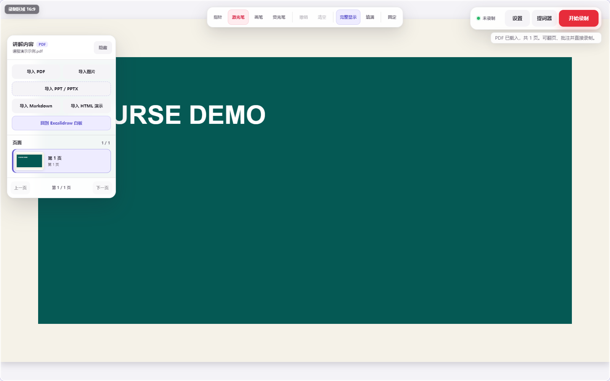

<div align="center">

# 见舟 · 画布录制

**边画边讲，自动聚焦重点，把白板、资料、人像和声音录成一段视频。**

面向课程讲师、知识创作者与培训演示人员的本地录制工作台。

Windows / macOS · 无需登录 · 无需 API Key · 当前版本 **0.1.0-beta.3**

**[下载 Windows 安装包](https://github.com/tangchengjiao/jianzhou-canvas-recorder-build/releases/download/v0.1.0-beta.3/Jianzhou-Canvas-Recorder-Beta-0.1.0-beta.3-Windows-x64-setup.exe)** · **[下载 Mac 安装包](https://github.com/tangchengjiao/jianzhou-canvas-recorder-build/releases/download/v0.1.0-beta.3/Jianzhou-Canvas-Recorder-Beta-0.1.0-beta.3-macOS-Universal.dmg)**

[全部发行版本](https://github.com/tangchengjiao/jianzhou-canvas-recorder-build/releases) · [使用手册](docs/见舟画布录制-用户使用手册.md) · [功能介绍](#功能介绍) · [联系见舟](#联系见舟)

</div>

## 下载安装

**普通用户直接下载下面的安装包即可，无需下载源码或安装开发环境。**

| 平台 | 版本 | 下载 | 安装方式 |
| --- | --- | --- | --- |
| Windows 10/11 x64 | 0.1.0-beta.3 | [Windows 安装程序（约 18.3 MB）](https://github.com/tangchengjiao/jianzhou-canvas-recorder-build/releases/download/v0.1.0-beta.3/Jianzhou-Canvas-Recorder-Beta-0.1.0-beta.3-Windows-x64-setup.exe) | 下载 `setup.exe` 后双击安装 |
| macOS 12+，Apple Silicon / Intel | 0.1.0-beta.3 | [Mac Universal DMG（约 39.0 MB）](https://github.com/tangchengjiao/jianzhou-canvas-recorder-build/releases/download/v0.1.0-beta.3/Jianzhou-Canvas-Recorder-Beta-0.1.0-beta.3-macOS-Universal.dmg) | 打开 DMG，将应用拖入“应用程序” |

**寻找后续新版本：**打开仓库右侧的 **Releases**，或直接收藏[发行版本页面](https://github.com/tangchengjiao/jianzhou-canvas-recorder-build/releases)。进入最新版本后，展开 **Assets**，Windows 选 `Windows-x64-setup.exe`，Mac 选 `macOS-Universal.dmg`。`Source code` 是源码压缩包。

安装说明：[Windows](DESKTOP_BETA.md) · [macOS](MACOS_BETA.md)。当前为 Beta：Windows 安装包未做商业代码签名；Mac 包尚未完成 Apple 公证，首次打开可能需要在“系统设置 → 隐私与安全性”中允许。Windows 缺少 WebView2 时，安装器会联网下载运行环境。

## 这个工具适合做什么

把一份提纲、一页白板或一组 PDF 变成有讲解、有批注、有重点镜头的视频，适合白板课、知识讲解、课程片段和产品方案演示。

你可以用 Excalidraw 直接绘图，也可以导入 PDF、图片、Markdown 或静态 HTML。讲解时用画笔或激光笔标出重点，输出镜头会平滑聚焦；同时可以显示摄像头人像、录入麦克风声音，并通过提词器辅助讲述。

**提词器、设置面板、选区框和录制按钮不会进入成片。**应用合成的是讲解画面，不是把整个电脑桌面直接录下来。



*现有演示截图。右侧输出预览与最终视频只包含合成画面。*

## 功能介绍

| 功能 | 可以做什么 |
| --- | --- |
| 白板讲解 | 使用 Excalidraw 绘制文字、图形、箭头与自由书写 |
| 资料演示 | 导入图片、PDF、Markdown、静态 HTML，翻页并逐页批注；PPT/PPTX 先导出 PDF |
| 自动运镜 | 根据画笔、激光笔等讲解动作平滑放大重点，结束后恢复全景 |
| 透明提词器 | 拖动、缩放、调速度、字号和透明度，提词内容不进入视频 |
| 摄像头画中画 | 选择设备，调位置、大小、形状和镜像 |
| 麦克风 | 选择输入设备，录制前进行 6 秒测试与电平检查 |
| 横竖版输出 | 支持 16:9、4:3、3:4、9:16、1:1、自定义比例、选区、720p/1080p 和背景样式 |
| 本地保存 | 优先输出 H.264/AAC MP4；系统不支持时回退 WebM，可选择保存文件夹 |
| 项目与恢复 | 保存内容源、提词器和输出设置；恢复中心管理本地会话与已落盘分片 |

运行时不需要账号、云服务或模型配置。字体和 PDF 解析资源随应用提供，画布、导入文件、提词稿与录制视频不会自动上传。详见[隐私说明](PRIVACY.md)。

## 第一次录制

1. 安装并打开应用，进入右上角“设置”。
2. 选择画幅、画质、录制选区和保存文件夹。
3. 需要人声或人像时，开启麦克风、摄像头并完成测试。
4. 在白板上准备内容，或从左侧“内容”导入资料；需要时打开提词器并粘贴脚本。
5. 点击“开始录制”，边讲边画；完成后结束录制，回看并确认文件。

首次建议录 10～20 秒，确认画面和声音。重启应用后需重新选择保存文件夹。

详细教程：[在线使用手册](docs/见舟画布录制-用户使用手册.md) · [下载 PDF 手册](https://github.com/tangchengjiao/jianzhou-canvas-recorder-build/releases/download/v0.1.0-beta.3/Jianzhou-Canvas-Recorder-User-Manual.pdf)。

## 当前版本说明

`0.1.0-beta.3` 已有 Windows 安装包和 macOS Universal 安装包。Windows 有安装后录制能力验证记录，Mac 有构建与应用启动记录；具体摄像头、麦克风和长时间录制仍需真机反馈。

- 当前适合短视频与课程片段内测，30 分钟和 2 小时真机长录尚未完成验收。
- MP4 输出取决于系统编码支持；不支持时保存 WebM。
- 静态 HTML 导入用于离线内容演示，不运行网页脚本或加载远程资源。
- 异常中断后可导出已保存分片，尚不保证不完整视频可以直接播放。
- 当前没有自动更新；后续版本从 [Releases](https://github.com/tangchengjiao/jianzhou-canvas-recorder-build/releases) 获取。

反馈问题时请提供系统版本、摄像头/麦克风型号、录制时长和复现步骤，可通过 [Issues](https://github.com/tangchengjiao/jianzhou-canvas-recorder-build/issues) 提交，或使用文末联系方式。

## 开发与源码运行

技术栈：React 18、TypeScript、Vite、Excalidraw、PDF.js、Tauri 2 和 Rust。

### Web 开发

按仓库构建配置使用 Node.js 22+、pnpm 11.7.0：

```powershell
corepack enable
corepack prepare pnpm@11.7.0 --activate
pnpm install --frozen-lockfile
pnpm dev
```

打开终端显示的本地地址，默认是 `http://127.0.0.1:5173`。浏览器版与桌面版的设备权限和保存能力取决于各自运行环境。

### 检查与构建

```powershell
pnpm typecheck
pnpm build
pnpm verify
```

`verify` 执行类型检查、构建和白板、文档、录制存储、媒体等回归，报告保存至本机 `artifacts/verify-report.json`。浏览器测试需要 Chrome 或 Edge，媒体测试需要 FFmpeg/ffprobe，并使用虚拟摄像头和麦克风。

Windows 桌面构建另外需要 Rust、MSVC C++ Build Tools、Windows SDK 和 WebView2：

```powershell
pnpm native:check
pnpm desktop:check
pnpm desktop:dev
pnpm desktop:build
```

Mac 构建在 macOS 上执行 `pnpm desktop:build:mac`；仓库中的 [macOS 构建工作流](.github/workflows/build-macos.yml) 提供云端构建。面向用户的成品统一放在 Releases。

### 项目结构

```text
src/                  页面、内容源、自动运镜、合成与录制
src-tauri/            Tauri 桌面壳、权限配置和平台适配
public/               随应用提供的字体等静态资源
scripts/              构建、回归与手册辅助脚本
docs/                使用手册、截图与联系图片
output/pdf/           已整理的 PDF 使用手册
.github/workflows/    macOS 云端构建
```

产品版本以 `src-tauri/tauri.conf.json` 为准；`package.json` 的 `0.0.1` 是 Web 工程内部版本。

## 项目文档

| 文档 | 用途 |
| --- | --- |
| [Windows 内测说明](DESKTOP_BETA.md) / [macOS 内测说明](MACOS_BETA.md) | 安装与设备权限 |
| [用户使用手册](docs/见舟画布录制-用户使用手册.md) | 从首次录制到常见问题 |
| [上传与发布清单](docs/发布与上传清单.md) | 哪些进源码仓库、哪些放 Releases、后续如何更新 |
| [产品路线图](PRODUCT_EXECUTION_ROADMAP.md) | 后续开发方向 |
| [稳定性报告](STABILITY_REPORT.md) | 历史验证与问题记录 |
| [隐私说明](PRIVACY.md) / [第三方说明](THIRD_PARTY_NOTICES.md) | 本地数据与上游组件 |

历史文档保留当时的状态，安装与下载以本 README 和 Releases 为准。产品层当前标记为 Proprietary；第三方组件版权和许可证归各自所有者。

<!-- JIANZHOU-CONTACT-QR:START -->
## 联系二维码

| 微信 | 抖音 | 视频号 | 公众号 |
| :---: | :---: | :---: | :---: |
|  |  |  |  |
| `DST10209` | `74683161410` | 见舟AI赋能 | 扫码关注 |
<!-- JIANZHOU-CONTACT-QR:END -->

<!-- JIANZHOU-PUBLIC-INFO:START -->
## 企业服务与联系

**华链 AI** · 企业 AI 业务落地与内生能力建设

培训与 FDE 培养 · 场景验证 · 智能体定制 · 企业实施 · 产品应用支持

[华链 AI 官网](https://hualian-ai.pages.dev) · [企业服务](https://hualian-ai.pages.dev/services/) · [服务参考价](https://hualian-ai.pages.dev/pricing/) · [企业宣传册](https://hualian-ai.pages.dev/downloads/company-brochure.pdf) · [合作咨询](https://hualian-ai.pages.dev/contact/)

咨询联系人：**见舟** · 微信：**`DST10209`**


<!-- JIANZHOU-PUBLIC-INFO:END -->
